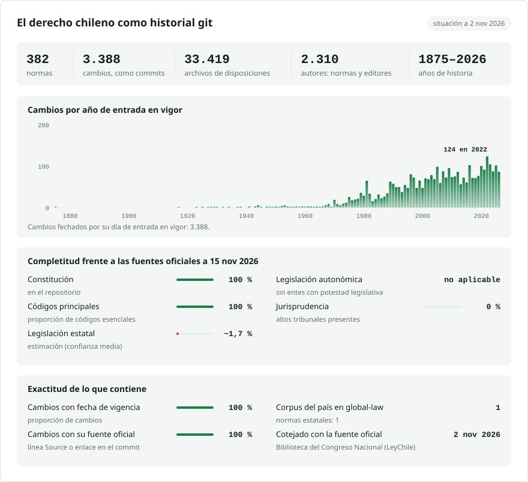

# Chile: historia del derecho en git

**Español** · [English](README.en.md)

<picture>
<source media="(prefers-color-scheme: dark)" srcset="data/es/effort-dark.svg">

</picture>

El derecho nacional de Chile como historia de git: un archivo por disposición, un commit por norma el día en que entró en vigencia, y la ley que hizo cada cambio como autor del commit. `git blame` indica la ley que está detrás de cada párrafo; `git log` enumera todos los cambios de un artículo; al elegir una fecha se obtiene el texto vigente ese día.

Forma parte de [lexifina/global-law](https://github.com/lexifina/global-law), una única historia de git para el derecho de todos los países: este es el derecho nacional de Chile, que global-law lee en `chile/national/acts/`.

**Qué contiene ahora:** la Constitución, 14 códigos y otras 367 leyes, decretos leyes y decretos con fuerza de ley, entre ellos el Código Civil, el Código Penal y el Código del Trabajo, con 4.590 versiones vigentes desde 1875 hasta 2026; 8 de esas normas fueron derogadas después, y su historia termina con una versión sin disposiciones. Otras 32 versiones, que entrarán en vigencia entre el 1 de diciembre de 2026 y el 2 de abril de 2029, están en la rama `futuro`. [`data/versions.json`](data/versions.json) enumera cada norma con el día en que entró en vigencia cada versión; [`data/laws.csv`](data/laws.csv) enumera todas las normas que el registro menciona, con sus fechas.

Cada norma es una carpeta con su nombre (`codigo-trabajo/`, `ley-19628/`, `dl-3500/`), con un archivo por artículo, disposición transitoria y encabezado: `codigo-trabajo/art-067.md` es el art. 67 del Código del Trabajo, sobre el feriado anual. El `README.md` de cada carpeta enumera sus disposiciones y cuándo cambió cada una.

El texto está en español, tal como lo publica LeyChile, un párrafo por línea, sin las notas de modificación de LeyChile ni las notas editoriales de la BCN.

## Preguntas como comandos de git

| Pregunta | Comando |
| --- | --- |
| Todos los cambios del art. 67 del Código del Trabajo | `git log -p --word-diff -- codigo-trabajo/art-067.md` |
| ¿Qué ley escribió cada párrafo del art. 67? | `git blame codigo-trabajo/art-067.md` |
| Todas las versiones del Código del Trabajo, con el día en que entró en vigencia cada una | `git log --format="%h %(trailers:key=In-force,valueonly,separator=) %an" -- codigo-trabajo ":^codigo-trabajo/README.md"` |
| El art. 67 vigente al 1 de enero de 2010 | `python tools/en_vigor_el.py 2010-01-01 codigo-trabajo 67` |

**Fuera de git**, también alojamos este registro de forma pública y gratuita:

- **[Preguntar a Claude sobre el derecho chileno](https://global-law.lexifina.com/v1/try_claude?country=chile)**: abre Claude con una primera pregunta preparada.
- **[Preguntar a ChatGPT](https://global-law.lexifina.com/v1/try_chatgpt?country=chile)**: la misma pregunta en ChatGPT.
- **[Buscar en el derecho chileno en nuestro sitio](https://lexifina.com/law?country=chile&q=feriado+anual)**: una búsqueda de "feriado anual", con el texto de cada disposición y sus versiones, sin necesidad de cuenta.
- **[API REST para desarrolladores](https://global-law.lexifina.com/v1/search_law?query=feriado+anual&jurisdiction=chile)**: la misma búsqueda en JSON, sin clave. Consulte la [documentación aquí](https://lexifina.com/api/global-law).

Ambos asistentes leen el registro a través del conector gratuito Global law (MCP, `https://global-law.lexifina.com/mcp`); la primera vez, el chat le da el enlace para agregarlo. Pregunte en español o en inglés.

**Alójelo usted mismo fácilmente.** Solo hacen falta git y Python, y las herramientas se ejecutan en su equipo:

```sh
git clone --depth 1 https://github.com/lexifina/global-law && cd global-law
python3 tools/countries.py add chile/national/acts
python3 tools/law.py show 2026-01-01 chile/national/acts/codigo-trabajo/art-067.md
```

Abierto en Claude Code, Cursor, VS Code o Codex, el clon también inicia un servidor MCP local con las mismas herramientas ([MCP.md](https://github.com/lexifina/global-law/blob/main/MCP.md)).

## Fechas

Cada commit está fechado a las doce del mediodía, hora de America/Santiago, del día en que el cambio entró en vigencia, y lleva ese día en su trailer `In-force:`, junto a `Published:`, el día del Diario Oficial:

- el día es el que LeyChile da a cada versión (`vigenteDesde`), que ya aplica la cláusula de vigencia propia de la ley; a falta de ella, el art. 7 del Código Civil hace obligatoria la ley desde su publicación en el Diario Oficial. Una norma cuyo propio texto difiere su entrada en vigencia a un día determinado comienza ese día (la Constitución de 1980, el 11 de marzo de 1981, seis meses después del plebiscito);
- cuando el día de LeyChile se aparta de los artículos transitorios de la propia ley modificatoria (entradas en vigencia graduales por región o por etapa, plazos computados de forma más breve que la que exige el art. 48 del Código Civil, redacciones vigentes solo hasta un día señalado), decide el texto de la propia ley; cada una de esas decisiones se enumera en `REPRODUCE.md`;
- git no puede almacenar fechas anteriores a 1970, por lo que los 95 commits anteriores (el Código Penal desde 1875 y diez normas de 1923 a 1968) están fechados a partir del 1970-01-01, con un segundo de diferencia entre sí, y llevan el día real en `In-force:`. Para consultar una fecha, use `tools/en_vigor_el.py`, no `git log --before`.

Cada cambio se atribuye a la ley que lo hizo, con una dirección que no puede existir (`Ley 21.645 <ley-21645@leychile.invalid>`), solo cuando una de las notas de modificación de LeyChile sobre la disposición menciona esa ley. Una primera versión que no es la norma tal como se promulgó ("versión más antigua disponible", 24 normas) y los 559 cambios que ninguna nota explica se atribuyen a quien los publica, `Biblioteca del Congreso Nacional (LeyChile)`; el committer es Lexifina.

## Cómo se verifica

- `tools/check_repo.py` vuelve a leer desde git cada versión el día en que entró en vigencia y el día anterior; ambas lecturas deben coincidir con el corpus, cuyo sha256 está en `data/corpus.sha256`: 4.622 versiones de 382 normas, 0 discrepancias ([`REPRODUCE.md`](REPRODUCE.md)).
- Cada versión de `data/versions.json` lleva el sha256 de los bytes de origen a partir de los cuales se analizó.
- El mismo corpus produce los mismos hashes de commit (`tools/build.py`); `REPRODUCE.md` deja constancia de que todavía no se ha comparado una segunda compilación.
- La historia solo admite agregados (`tools/append.py`): no hay commits de fusión (merge) en `main`, ni fechas de commit que retrocedan, ni nada fechado en el futuro, y los trailers de todos los commits se analizan sin errores.
- [vulnerabilities/](vulnerabilities/): posibles errores de redacción en este derecho, hallados por los detectores de global-law y revisados a mano. Aún no se ha ejecutado.

## Qué no muestra

- **Todo el derecho nacional.** Son 382 normas, no la totalidad de la legislación; no están aquí los reglamentos y otros decretos, las ordenanzas municipales ni la jurisprudencia.
- **Los cambios anteriores a la primera versión de una norma**, que quedan dentro de ese primer commit: el Código Civil comienza en su texto refundido de 2000 (LeyChile conserva el código de 1855 con solo tres versiones y sin normas modificatorias), el Código de Comercio en 1988 y el Código del Trabajo en 1994; las normas cuyas versiones más antiguas en LeyChile no se incluyen comienzan en su primera versión de 1970 en adelante (el DFL 340 de 1960, desde 1975).
- **Notas e imágenes.** Las notas de LeyChile se usan solo para atribuir los cambios a las leyes, y el texto publicado solo como imagen (como una tabla de gradualidad) no se lee.
- **Las disposiciones que esperan un hecho sin fecha**, como las partes de la Ley 21.770 que esperan decretos y reglamentos aún no publicados, y las reglas que aplican una disposición solo a los casos iniciados después de un día: ninguna de las dos se refleja en las fechas.
- **Qué ley hizo algunos cambios.** Los 559 cambios que ninguna nota de modificación explica se atribuyen a la BCN.

## Fuentes

| Fuente | Tipo | Versiones anteriores | Notas |
| --- | --- | --- | --- |
| [LeyChile](https://www.bcn.cl/leychile) (Biblioteca del Congreso Nacional de Chile) | Legislación oficial | sí, todas las versiones por fecha | El texto de cada versión, las normas que le pusieron fin y el día en que entró en vigencia cada una; sus notas indican la ley detrás de cada cambio |
| [Diario Oficial](https://www.diariooficial.interior.gob.cl) | Diario oficial | no corresponde | La Ley 21.057 tal como se publicó el 20 de enero de 2018 (edición 41.962), para sus versiones anteriores al 3 de octubre de 2022, día desde el cual la ofrece LeyChile |

## Licencia

Véase [`LICENSE`](LICENSE). Los textos normativos son textos oficiales de la República de Chile, reproducidos con la atribución "Fuente: Biblioteca del Congreso Nacional de Chile, LeyChile (www.bcn.cl/leychile)"; la BCN no publica ninguna licencia para LeyChile, y la ley chilena de propiedad intelectual (Ley 17.336) no excluye expresamente los textos normativos, por lo que aquí no se confirma la situación de estos textos en materia de derecho de autor. Las contribuciones propias de Lexifina (la organización, los mensajes de commit, las tablas y las herramientas) son CC0 1.0.

Ningún modelo de IA escribió, tradujo ni corrigió texto normativo, y ninguno se ejecuta durante la compilación; los scripts los escribió Claude Code con Claude Opus 5.5 (véase [`REPRODUCE.md`](REPRODUCE.md)).

Esta es una traducción de la versión inglesa ([README.en.md](README.en.md)); si difieren, prevalece la versión inglesa.

## Visualizaciones

- [visualisations/](visualisations/): gráficos hechos a partir de este repositorio. Aún no se han hecho.

## Más información

Del repositorio [lexifina/global-law](https://github.com/lexifina/global-law) (páginas en inglés):

- [FEATURES.md](https://github.com/lexifina/global-law/blob/main/FEATURES.md): todas las funciones y lo que cada corpus debe admitir (`git blame`, `law.py`, herramientas MCP)
- [FAQ.md](https://github.com/lexifina/global-law/blob/main/FAQ.md): preguntas y respuestas · [CONTRIBUTING.md](https://github.com/lexifina/global-law/blob/main/CONTRIBUTING.md): proponer cambios · [MCP.md](https://github.com/lexifina/global-law/blob/main/MCP.md): servidor MCP · [REPRODUCE.md](https://github.com/lexifina/global-law/blob/main/REPRODUCE.md): cómo se ha construido · [CHANGELOG.md](https://github.com/lexifina/global-law/blob/main/CHANGELOG.md)
- [FRESHNESS.md](https://github.com/lexifina/global-law/blob/main/FRESHNESS.md): lo actualizado que está cada corpus · [Supervisión](https://github.com/lexifina/global-law/tree/main/monitoring): si las actualizaciones funcionan · [WATCHING.md](https://github.com/lexifina/global-law/blob/main/WATCHING.md): cómo se vigila cada fuente oficial para detectar cambios
- [performance/](https://github.com/lexifina/global-law/tree/main/performance): la rapidez de las herramientas, medida
- [visualisations/](https://github.com/lexifina/global-law/tree/main/visualisations): gráficos y conexiones a través del derecho de todo el mundo
- [Vulnerabilidades](https://github.com/lexifina/global-law/tree/main/vulnerabilities): errores en las normas tal como se publicaron
